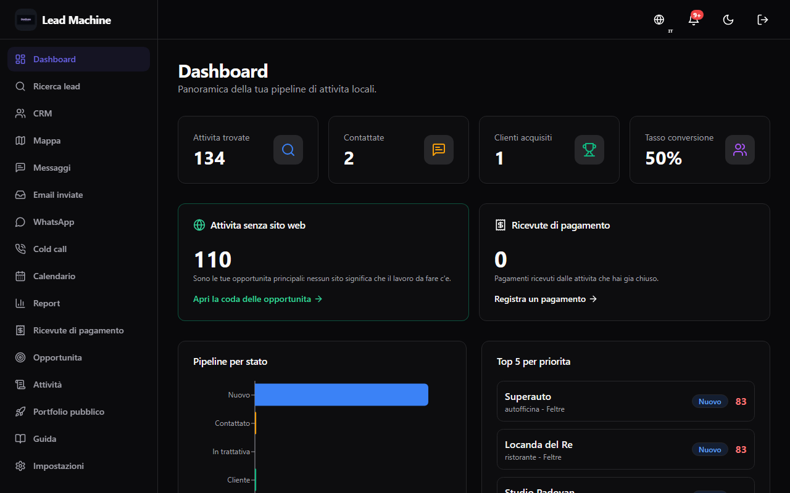
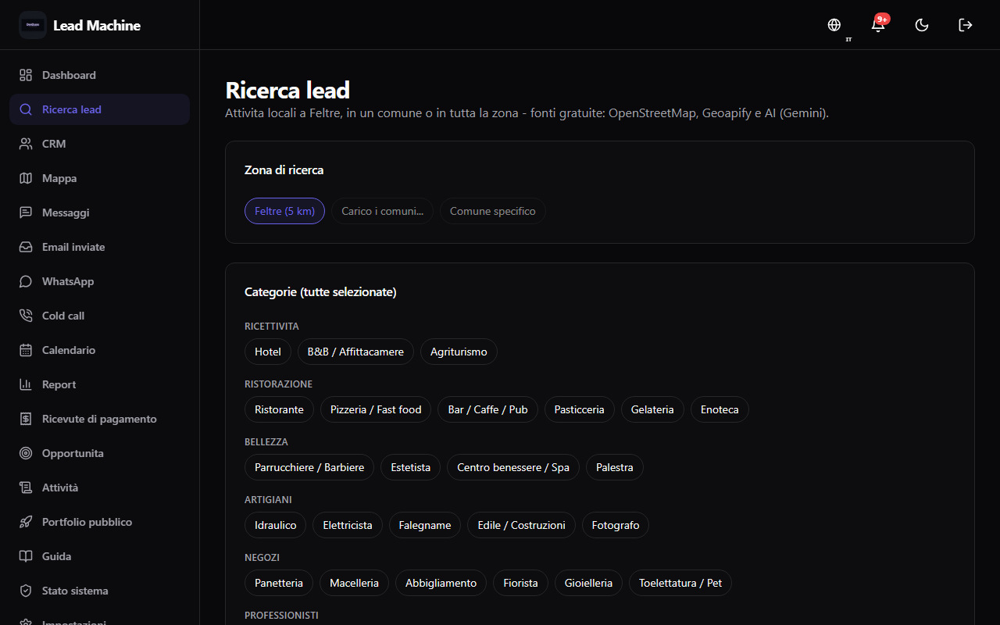
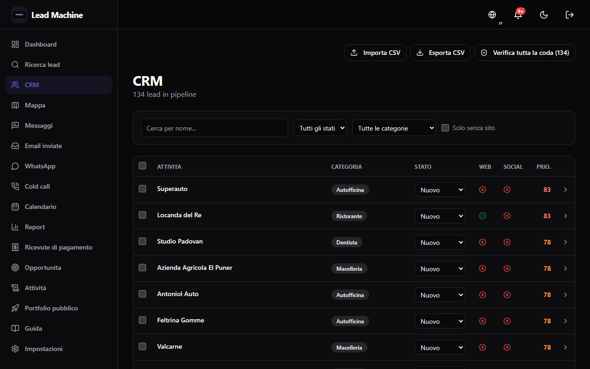
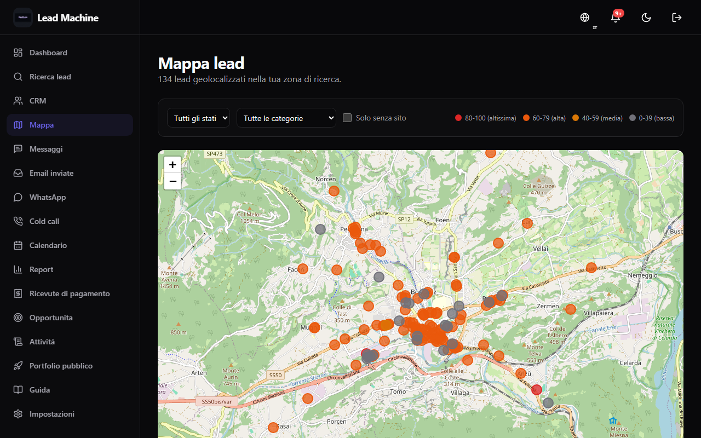
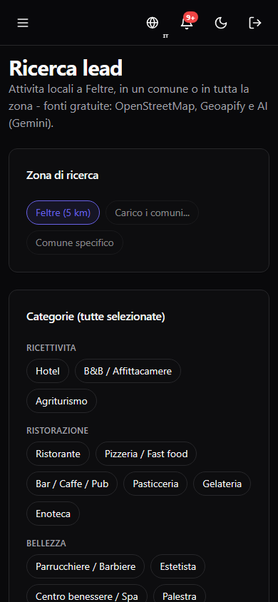
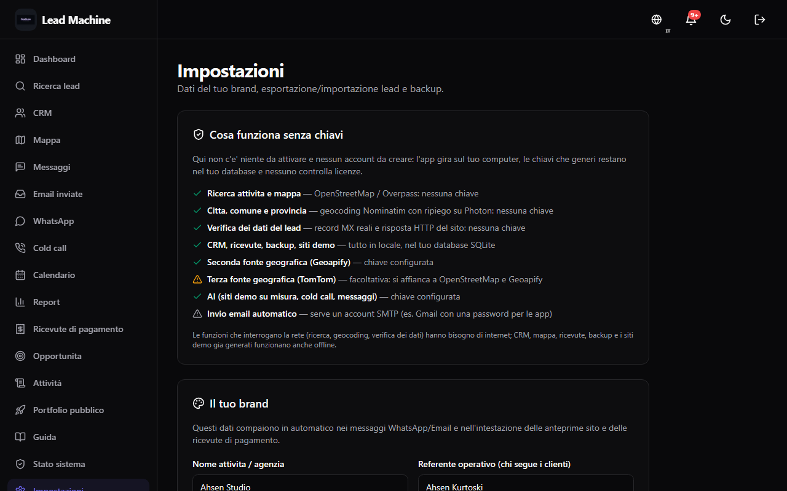

# Lead Machine

> **Open-source, self-hosted, local-first lead generation platform for freelancers and small agencies.**
> Find nearby businesses on OpenStreetMap, score them, verify their contact data and reach out — with optional AI help — **for €0 in subscriptions**.

<div align="center">

**✨ [Features](#-features) · 🚀 [Quick start](#-quick-start) · 🌍 [Locales supported](#-multilingual-support--locales) · ✅ [Testing](#-testing--verification) · 🛡️ [Security](./SECURITY.md) · 🤝 [Contributing](./CONTRIBUTING.md)**

[](#)
[](#)
[](#)
[](#)
[](#)
[](#)
[](./LICENSE)

---
**👨‍💻 Created by Ahsen Kurtoski**
*The perfect blend of human vision and AI execution.*
**Idea & Vision:** Ahsen Kurtoski (teenager developer & visionary)
**AI Execution:** Built flawlessly by Artificial Intelligence
</div>

---

<div align="center">


</div>

## 📸 Screenshots

| Dashboard | Ricerca lead | CRM |
|---|---|---|
|  |  |  |

| Mappa | Ricerca lead (mobile) | Impostazioni |
|---|---|---|
|  |  |  |

> Tutti gli screenshot sono generati dal codice reale: con il server avviato, `APP_PASSWORD=… npm run screenshots` (PNG desktop + mobile) e `node scripts/demo-gif.mjs` (GIF). Lo script effettua il login, fotografa dashboard, ricerca, CRM, mappa, ricevute e impostazioni; le versioni mobile sono in `screenshots/`.

---

## Why Lead Machine?

Freelancers and small web agencies waste dozens of hours per year on **subscription tools** just to find, contact, and follow up with local prospects. The typical stack costs €50–€200/mo and locks your data inside a SaaS.

**Lead Machine fixes this** with a single, open-source Next.js app that runs on your laptop:

- ✅ **Free forever** (MIT license). No paid tiers, no "pro upgrade" walls.
- ✅ **Your data stays yours** — a single `prisma/dev.db` SQLite file, portable to any machine.
- ✅ **100% offline-friendly** (except when calling the optional AI providers or the live Overpass / OSM APIs).
- ✅ **Self-contained build pipeline**: `npm run build` just works (tried on macOS, Linux, Windows).
- ✅ **Made for humans**: modern, responsive UI with dark mode, 7 interface languages, and WCAG 2.1 AA-aware accessibility.

---

## ✨ Features

Everything is built-in — no plugins to buy:

### 🔎 Research & Prospecting
- **Geographic search**: query **OpenStreetMap (Overpass)** by category + radius + city, with automatic failover across public mirrors. Optional **second source: Geoapify** (free tier) — results from both sources are merged and deduplicated.
- **Deduplication engine** with 3 layers (OSM ID, then `name+city`, then fuzzy) to avoid polluting your CRM.
- **Website finder**: given a lead, find its official homepage (AI + free DuckDuckGo fallback) and the social profiles it links to — directories and marketplaces are filtered out.
- **Screenshot pipeline** (Playwright): one-click homepage preview so you know what to fix before calling.
- **Map view** (Leaflet) with color-coded lead statuses.

### 🧭 City-agnostic setup & search
- **First-run onboarding** (`/onboarding`): the code ships **no default city and no default brand**. On first start the app asks for your brand, your name and the city where you look for clients. It can be skipped and filled in later from *Impostazioni*.
- **Automatic geocoding** (Nominatim / OpenStreetMap, no API key): the city you type is turned into coordinates, so search, map and demo sites are centered where you actually work.
- **Search area resolution**, in this order: explicit `lat`/`lng` in the request → geocoded city → coordinates saved in your settings. Nothing is invented: with no area configured the endpoint answers `400` and a clear message.
- The area you configure is used by search, the map, the priority scoring and the message templates.

### 🧠 Lead Scoring & Priority
- **0–100 rule-based priority score** based on what the lead actually has: missing or broken website, social presence, review count and rating, and available phone/WhatsApp/email. No distance, affluence or OSM-timestamp guesswork.
- **Heatmap dashboard** to understand **when** you were most productive (hours vs. days).
- **Tags** (hot / warm / cold / bespoke) and **custom statuses** for every stage of the funnel.

### ✅ Data verification (know what is true before you call)
- Every lead field — **phone, email, website, address, social** — gets a verdict: `verificato`, `da_verificare`, `non_raggiungibile`, `non_valido`, `assente`.
- Each verdict carries a **source** (`openstreetmap`, `controllo_diretto`, `ricerca_web`), a **human-readable explanation** and the time of the check; results are stored per lead (`Verification`), so nothing is re-checked blindly.
- What the checks cover: phone shape (landline/mobile), email syntax with disposable-domain and (when available) MX checks, live website reachability, address completeness and whether social links exist. A stored WhatsApp number or social link is **not** proof of ownership, so those fields stay `da_verificare`.
- A **verification panel** in the lead detail (**Verifica ora**), an honest `verified / pending / problems` summary and duplicate-group detection.
- Routes: `GET /api/leads/{id}/verification`, `POST /api/leads/{id}/verify`, `POST /api/leads/verify` (bulk).

### 🔌 Public API for external projects (`/api/v1/*`)
- Generate an **API key** from *Impostazioni → API Key & Integrazioni esterne* and connect Lead Machine to a website builder, a script or any other tool.
- Keys are stored **hashed (SHA-256)**; the secret is shown exactly once. Each key can be suspended or revoked with one click.
- **Four access profiles** — full integration, business search, read only, insert only — plus a custom combination. Permissions are *really enforced* on every call: a key without the `search` permission gets a `403` with `requiredScope` in the body, it is not a decorative label.
- Authenticate with `x-api-key: lm_live_…` or `Authorization: Bearer lm_live_…`. `CORS` is enabled, so it works from any browser domain or port.
- Endpoints: `GET /api/v1/leads` (filter by city, category, website presence, score), `GET /api/v1/leads/{id}`, `POST /api/v1/leads` (create), `POST /api/v1/search` (live OpenStreetMap search), `POST /api/v1/demo/generate` (AI website for a lead).
- Requests are never left hanging: every source has a time budget and the response carries a `warnings` array explaining what was unavailable.
- Rate limits are counted **per key** (not per IP), so several projects never block each other, and return `429` with `Retry-After`.
- Full reference: [API.md](./API.md#19-public-api-for-external-projects-api-v1).
- End-to-end checks: `npm run smoke:api` (profiles, scopes, auth, CORS and 404s, against a running instance) and `npm run smoke:geo` (live OpenStreetMap + Geoapify search, `SMOKE_BASE=http://localhost:3111`).
- Unit tests: `npm test` runs the Node built-in test runner (`node:test` + `tsx`, no extra framework) over the pure helpers in `src/lib/` — the verification engine and its retry queue, the receipt helpers, search-area resolution, geocoding parsing, onboarding rules, opportunity scoring, currency formatting and the Overpass query builder.
- Hygiene guard rails: `npm run check:hygiene` fails on an empty page, a link or menu entry pointing at a removed route, an unreachable page, a `layout` without a `page`, an empty folder — and, when the database exists, on leftover smoke-test data or verification rows that are orphaned, duplicated or outside the rules.
- The app itself also exposes `/api/onboarding`, `/api/leads/{id}/verify`, `/api/leads/verify`, `/api/leads/verify/retry`, `/api/leads/{id}/verification`, `/api/leads/{id}/enrich` and `/api/receipts` — all documented in [API.md](./API.md).

<details>
<summary><b>🔑 How to get an API key — step by step (humans & AI agents)</b></summary>

**What you need**: a running instance (`npm install && npm run setup && npm run dev`) and nothing else. AI endpoints additionally need a free provider key in `.env` (`GEMINI_API_KEY` or `GROQ_API_KEY`).

1. Open **Impostazioni → API Key & Integrazioni esterne** at <http://localhost:3000/impostazioni>.
2. Pick a profile — *full integration* (`read,write,search,ai`), *business search* (`read,search`), *read only* (`read`), *insert only* (`write`) — or a custom scope set.
3. Name the key and click **Crea chiave**. The secret `lm_live_…` is shown **once**; only its SHA-256 hash is stored.
4. Call the API with either header:

```bash
curl http://localhost:3000/api/v1/leads?take=1 -H "x-api-key: lm_live_…"
# oppure: -H "Authorization: Bearer lm_live_…"
```

5. Prefer automation? Create the key from the command line:

```bash
curl -X POST http://localhost:3000/api/keys \
  -H "Content-Type: application/json" \
  -d '{"name":"My AI Agent","permissions":"read,search"}'
# → { "ok": true, "apiKey": { … }, "rawKey": "lm_live_…" }
```

Errors are machine-readable: `401` invalid key, `403` with `requiredScope` + `currentScopes` when a scope is missing, `429` with `Retry-After` on rate limits. Full contract (scopes, limits, CORS, error codes): [API.md → § 19](./API.md#19-public-api-for-external-projects-api-v1).

</details>

### 📞 Multi-channel CRM
- Unified timeline with **calls, emails, WhatsApp, meetings, research notes, follow-ups**.
- **Email**: compose with an HTML/Markdown editor, optional SMTP send, fallback to `.eml` local files.
- **WhatsApp**: one-click deep-link to `wa.me/<phone>` with a per-lead template.
- **Follow-up buckets** ("today / next 7 days / overdue / done") so nothing slips.

### 🧾 Payment receipts (not a fiscal document)
- Register what a client actually paid: **number** (`RICEVUTA-2026-001`), **amount**, **method** (cash / bank transfer / card / other), **date** and notes.
- Printable receipt (`/ricevuta`, `/ricevuta/{id}`) and the full list of payments per client, with amounts formatted in your locale's currency.
- Explicitly **no VAT, no tax rates, no invoices**: the app tracks the payment, not the paperwork.

### 📈 Opportunities, Portfolio & Reports
- **Opportunity queue** (`/opportunita`): the businesses with **no website**, ranked by how much they need you, with one-click call / email / WhatsApp and a city filter.
- Drag-and-light **Portfolio showcase** page (great for personal brand).
- Reports with **funnel by status**, city breakdown, tag breakdown, top N leads by score and CSV / JSON export.

### 🤖 AI (optional)
- **Gemini** + **Groq** providers with **automatic failover**. If one key is missing or returns an error, the other is tried. Results are deterministic per-input where feasible.
- Use cases:
  - Elevator-pitch cold-call scripts,
  - Follow-up email drafts,
  - Lead-score justifications,
  - **Website & contact enrichment**: find a lead's official site and social profiles and report how confident the guess is,
  - **Demo websites**: a complete one-page showcase built from the lead's real data, previewable at `/demo/{id}`.

### 🌍 Multilingual support & locales

The interface is translated into **7 languages**, with per-country formatting:

| Flag | Code | Language | Currency default | Date format | Distance unit | Typical countries |
|---|---|---|---|---|---|---|
| 🇮🇹 | `it` | **Italiano** | EUR (€) | `DD/MM/YYYY` | km | Italia, Svizzera (TI), Città del Vaticano, San Marino |
| 🇩🇪 | `de` | **Deutsch** | EUR (€) | `DD.MM.YYYY` | km | Deutschland, Österreich, Schweiz (DE), Südtirol (IT) |
| 🇫🇷 | `fr` | **Français** | EUR (€) | `DD/MM/YYYY` | km | France, Belgique, Suisse (FR), Luxembourg, Monaco |
| 🇸🇮 | `sl` | **Slovenščina** | EUR (€) | `DD. MM. YYYY` | km | Slovenija, border areas with IT/AT |
| 🇺🇸 | `en` | **English (US)** | USD ($) | `MM/DD/YYYY` | mi | United States, Canada (EN), IE, UK, AU, NZ, ZA |
| 🇪🇸 | `es` | **Español** | EUR (€) | `DD/MM/YYYY` | km | España, México, Argentina, Colombia + LATAM |
| 🇵🇹 | `pt` | **Português** | EUR (€) / BRL fallback | `DD/MM/YYYY` | km | Portugal, Brasil, Angola, Moçambique |

- **Language coverage**: navigation, forms and core CRM flows are translated in all 7 languages; some domain-specific copy, seeded templates and AI-generated demo text remain Italian-first.
- **Switch language anytime** via the 🌐 Globe dropdown in the top-right corner (persisted in `localStorage`, syncs to the `<html lang>` attribute for a11y + SEO).
- Formatting uses `Intl.DateTimeFormat`, `Intl.NumberFormat` and `Intl.NumberFormat(currency)` **under the hood** — dates, numbers, currency and distances are natively correct for each locale.
- Settings `locale` + `currency` are also in the DB so API routes (server-side emails, receipts) can use the same format without needing React context.

### ♿ Accessibility (WCAG 2.1 AA aware)
- **Skip-to-content** link as first focusable element on every page.
- **Semantic landmarks**: `<header role=banner>`, `<nav>`, `<main id=main-content role=main tabIndex=-1>`, `<aside>`, `<footer>`.
- Correct ARIA on dropdowns, dialogs, tabs (`aria-expanded`, `aria-controls`, `aria-haspopup`, `aria-selected`, `aria-modal`, `aria-labelledby`, `role="listbox" / "option"`, `aria-live` for unread counts, `sr-only` labels for icon buttons).
- Visible focus rings (`focus-visible` on every interactive element).
- Respects system **prefers-reduced-motion** where feasible.
- Colors inherited from the shadcn/ui palette (contrasts are AA-safe on foreground/background pairs — test it with axe if you want to be 100% sure).

### 🔒 Security (self-hosted by default)
- **Password-protected app**: set `APP_PASSWORD` (at least 8 characters). Sessions are signed HttpOnly cookies; without a password, protected pages and APIs fail closed with a clear `503` on every host.
- **CSRF protection**: cookie-authenticated mutations must be same-origin. `/api/v1/*` is exempt because it uses API keys, not session cookies.
- **Security headers**: CSP, HSTS in production, `X-Frame-Options`, `nosniff`, Referrer-Policy and Permissions-Policy are set in `next.config.mjs`; remote `next/image` hosts are disabled.
- **SSRF guard**: user-supplied website URLs are resolved and private, loopback and link-local targets are rejected before HTTP checks, screenshots or Playwright navigation.
- **Sandboxed demo previews**: generated demo HTML runs in an iframe without scripts and without a referrer.
- **Rate limiting** (in-memory) on login, writes, emails, verification and AI endpoints. Set `TRUST_PROXY=1` only behind a proxy you control; otherwise forwarded headers are ignored.
- **Input sanitization** + typed coercion: `asString / asNumber / asBoolean / asArray`, HTML escaping, URL normalization and email validation.
- **Settings whitelist** and **secret redaction**: only known keys can be written; `*_api_key` and `*_pass` values are returned masked and masked values are refused on write.
- **Prisma parameterized queries and transactions**: atomic writes on imports, receipts and bulk operations.

See [SECURITY.md](./SECURITY.md) for the full policy, audit scope and disclosure process.

---

## 🌐 Website & live demo

This repository contains **only Lead Machine, the app**. The public marketing site and the in-browser demo are maintained as a separate project.

- 🌍 **Live demo**: <https://website-mocha-one-59.vercel.app> — real OpenStreetMap search, rule-based lead scoring, cold-email generation in your browser.
- 💻 **This repo**: everything you need to self-host Lead Machine (app + docs + CI).

---

## 🚀 Quick start

### 1. Prerequisites

| Tool | Minimum version | Notes |
|---|---|---|
| **Node.js** | `18.18 LTS` (or `20 LTS`, `22`) | `node -v` to check. We recommend 20 LTS. |
| **npm** (or pnpm / yarn) | Comes with Node | `npm -v` ≥ 10 works. |
| That's it. | — | SQLite is file-based — **no Postgres / MySQL install needed**. |

#### 🔑 How to get your free API Keys (Optional but recommended)
Lead Machine uses AI to generate outreach scripts and score leads. You can use Gemini, Groq, or both (for automatic failover).

**Google Gemini (Recommended for quality)**
1. Go to [Google AI Studio](https://aistudio.google.com/).
2. Sign in with your Google account.
3. Click **"Get API key"** in the left menu, then **"Create API key"**.
4. Copy the key (it starts with `AIza...`).
5. Paste it in your `.env` file as `GEMINI_API_KEY=AIza...`

**Groq (Recommended for blazing speed)**
1. Go to the [Groq Console](https://console.groq.com/keys).
2. Sign in or create an account.
3. Click **"Create API Key"** and copy the string (it starts with `gsk_...`).
4. Paste it in your `.env` file as `GROQ_API_KEY=gsk_...`

Other optional prerequisites:
- **SMTP server** (Gmail with app password, SendGrid, Brevo…). Without SMTP the app writes `.eml` files to `./tmp/emails` so you can still inspect them locally.
- **Playwright / Chromium** (for homepage screenshots) — install via `npm run setup:screenshot`.

### 2. Install & run

```bash
# Clone
git clone https://github.com/AhsenKurtoski/lead-machine.git
cd lead-machine

# Install dependencies
npm install

# Copy env template
copy .env.example .env        # Windows (PowerShell / CMD)
# cp .env.example .env        # macOS / Linux / WSL

# Required to use the app (at least 8 characters):
#   APP_PASSWORD=choose-a-strong-password

# Create the SQLite DB + default templates, tags and neutral settings
npm run setup

# 🚀  Start the dev server
npm run dev
```

👉 Then open <http://localhost:3000> in your browser. On a fresh database you land on the **first-run setup**: enter your brand and the city where you look for clients (it is geocoded automatically). Skip it and you go straight to the **Dashboard**, which is **empty by design** — no sample, demo or fake business is ever inserted: you fill the CRM with real leads from **Ricerca** (OpenStreetMap), and your search area comes from the city you just configured.

On Windows PowerShell, replace `cp` with `copy`; `&&` with `;`. The npm scripts already handle cross-platform steps.

### 3. Optional: build for production

```bash
# Build for prod (prisma generate + next build)
npm run build

# Then start the production server
npm start             # http://127.0.0.1:3000, local only
npm run start:public  # 0.0.0.0, only with APP_PASSWORD and a TLS proxy in front
```

Behind a reverse proxy (Nginx, Caddy, Traefik, etc.) set `NEXT_PUBLIC_BASE_URL` to your canonical URL and `TRUST_PROXY=1` so rate limits use the proxy's forwarded client IP. Do not set `TRUST_PROXY` when the app is reachable directly.

---

## 🛠️ Environment variables (`.env`)

Edit `.env` (created from `.env.example`). `DATABASE_URL` points to your SQLite file and `APP_PASSWORD` (at least 8 characters) is required to use the app; without it protected pages and APIs answer `503`.

| Variable | Default | Purpose |
|---|---|---|
| `DATABASE_URL` | `file:./dev.db` | SQLite location (relative to `prisma/`). |
| `NEXT_PUBLIC_BASE_URL` | `http://localhost:3000` | Canonical public URL (used in emails, ics, deep links). |
| `APP_PASSWORD` | *(empty)* | Required to use the app (min 8 chars). Shared password for the single-user session; changing it invalidates all sessions. Without it, protected routes fail closed with `503`. |
| `TRUST_PROXY` | *(empty)* | Set to `1` only behind a trusted reverse proxy so rate limits use `X-Forwarded-For`; leave empty otherwise to prevent spoofing. |
| `GEMINI_API_KEY` | *(empty)* | Optional. Google AI Studio key. |
| `GROQ_API_KEY` | *(empty)* | Optional. Groq key. If both are set, Groq is tried first, then Gemini on failure. |
| `GEOAPIFY_API_KEY` | *(empty)* | Optional. Second geographic source (free tier at <https://myprojects.geoapify.com/>). |
| `OSM_CONTACT_EMAIL` | *(empty)* | Optional. Contact sent to OpenStreetMap (Overpass and Nominatim) to identify your requests. Not a key: leave it empty and the app sends the project URL instead. A placeholder such as `you@example.com` is ignored on purpose — Nominatim rejects placeholder addresses with `403`, which would break geocoding. |
| `SMTP_HOST` | *(empty)* | Optional. SMTP hostname (e.g. `smtp.gmail.com`). |
| `SMTP_PORT` | `587` | `587` (STARTTLS) or `465` (implicit TLS). |
| `SMTP_USER` | *(empty)* | SMTP username (often your email). |
| `SMTP_PASS` | *(empty)* | SMTP password / app password. Never commit this. |
| `SMTP_FROM` | *(empty)* | RFC 5322 sender, e.g. `"La Tua Web Agency" <hello@example.com>`. |
| `NEXT_PUBLIC_APP_NAME` | `Lead Machine` | Brand name shown in the navbar + emails. |
| `NEXT_PUBLIC_TZ` | `Europe/Rome` | Default timezone for date formatting. |

> Never commit `.env` to git. It's already in `.gitignore`.

---

## 🧭 Feature walkthrough (one paragraph each)

1. **Dashboard** (`/dashboard`) — KPIs, 4 charts, top leads, upcoming follow-ups. On a fresh database you first pass through **`/onboarding`** (brand, name, search city).
2. **Ricerca / Lead Research** (`/ricerca`) — search OSM by keyword + radius, import candidates, run website research in bulk, tag and score.
3. **CRM / Lead list** (`/crm`) — filterable, sortable list; bulk actions (set status, add/remove tags, delete); open a detail drawer with timeline, **data verification panel** and the web actions (find site, enrich, generate demo).
4. **Map** (`/mappa`) — interactive Leaflet map with color-coded pins; click a pin for lead summary and quick actions (call, email, WhatsApp, open).
5. **Ricevute / Receipts** (`/ricevuta`) — register a payment (amount, method, date), print the receipt, keep the list of what each client paid.
6. **Follow-ups** (`/crm`) — per-lead follow-ups with due dates, automatic bucketization ("today" / "this week" / "overdue").
7. **Opportunita without a website** (`/opportunita`) — the queue of leads with no site, ranked by priority, with one-click call / email / WhatsApp. **Portfolio** (`/portfolio`) showcases your best work.
8. **Guida / Guide** (`/guida`) — a short in-app manual with screenshots and copy/paste templates for cold outreach.
9. **Report** (`/report`) — more detailed business analytics (revenue over time, cohort by status, tag/city splits).
10. **Stato sistema** (`/health`) — scans the project, database, auth and security configuration, and optional integrations; it says plainly what works, what is only a warning, and what is broken, without ever showing a secret.
11. **Settings** (`/impostazioni`) — brand info, locale/currency defaults, AI & SMTP keys, tags & categories cleanup.

---

## 🧰 Tech stack

| Layer | Choice | Why |
|---|---|---|
| **Framework** | **Next.js 15 App Router** | File-based routing + SSR + API routes in one process; great cold start even on hobby deploy. |
| **Language** | **TypeScript strict** | Catches most bugs at compile-time. |
| **Styling** | **Tailwind CSS 3 + shadcn/ui** | Consistent, accessible, hackable UI primitives. |
| **Data layer** | **Prisma ORM + SQLite** | Zero-DB-admin, file-portable, great DX. |
| **Map** | **Leaflet + OpenStreetMap tiles** | Free, tile-based, no Google Maps key required. |
| **Email** | **nodemailer** | Battle-tested. |
| **Charts** | **Recharts** | Composable SVG charts with responsive sizing. |
| **AI** | **Google Gemini + Groq** (direct HTTP API, no vendor SDK) | Two providers for redundancy, with automatic failover and model fallbacks. |
| **Screenshots** | **Playwright (optional)** | Modern, reliable, installs its own Chromium. |
| **i18n** | **Custom implementation** (dictionaries + `Intl`) | Lightweight, no extra dependencies, App-routers + Server Components friendly. |
| **Auth** | **Shared password + signed session cookie** | Single-user tool: one `APP_PASSWORD`, HttpOnly cookie, fail-closed `503` when unset. |

---

## 📁 Project layout

```
lead-machine/
├── prisma/
│   ├── schema.prisma     # DB model (Lead, Tag, Location, Activity, FollowUp, Appointment, MessageTemplate, GeneratedMessage, Notification, Setting, Verification, Receipt, EmailLog, ApiKey)
│   └── seed.ts           # Message templates, tags and neutral settings — no sample data (npm run db:seed)
├── public/               # Static assets (logo, favicon, og image)
├── src/
│   ├── app/              # App Router: pages + /api/* routes
│   ├── components/       # UI: app-shell, charts, forms, cards, locale-switcher, theme-toggle…
│   └── lib/              # Pure helpers + clients (prisma, mailer, ai, scoring, verify, receipts, onboarding, geocode, search-area, opportunities, security, i18n)
├── .env.example
├── CONTRIBUTING.md
├── CHANGELOG.md
├── SECURITY.md
├── CODE_OF_CONDUCT.md
├── API.md
├── DEPLOY.md
├── REELS_GUIDE.md
├── LICENSE
├── README.md
└── package.json
```

See [CONTRIBUTING.md](./CONTRIBUTING.md) for a deeper tour and the PR workflow.

---

## 🐳 Deployment

For **localhost use**, nothing beyond the Quick Start above is needed.

If you'd like to host Lead Machine on a VPS, Vercel (⚠️ note about ephemeral SQLite), Fly.io, Coolify, etc — see [DEPLOY.md](./DEPLOY.md). It covers:

- Reverse proxy with Caddy / Nginx (HTTPS, with optional Basic Auth as a second layer).
- SQLite backups (cron + rclone to S3-compatible storage).
- Moving to Postgres (single `DATABASE_URL` change, Prisma handles the rest).
- Vercel / serverless caveats (⚠️ you will lose your DB on cold restarts unless you attach a persistent volume).

---

## 🛟 Troubleshooting

<details>
<summary><b>I'm on Windows and <code>prisma db push</code> fails with an ENOTDIR / permission error.</b></summary>

Make sure the `prisma/` directory exists (it's in this repo) and that your antivirus / Windows Defender isn't locking the `dev.db-journal` file. Run your terminal **as a normal user** (not Administrator, which can cause weird `$env:TEMP` issues).

</details>

<details>
<summary><b>AI calls return 503 ("No AI provider configured").</b></summary>

Set at least one of `GEMINI_API_KEY` or `GROQ_API_KEY` in `.env`, then restart the dev server (API routes cache env at module-load time in Next.js). If both keys are present, Groq is tried first; if it throws, the request transparently falls back to Gemini.

</details>

<details>
<summary><b>Emails are not being sent; I see "stored locally" in the response.</b></summary>

This is **intentional behavior** when `SMTP_HOST` is empty (the safe local-default). The email is written as an `.eml` file to `./tmp/emails/` for inspection. Once you fill in `SMTP_HOST / SMTP_PORT / SMTP_USER / SMTP_PASS` and restart the app, real SMTP is used.

</details>

<details>
<summary><b>Map is empty / tiles don't load.</b></summary>

Leaflet loads tiles from the public OpenStreetMap CDN, so you need internet. If you're on a corporate network with heavy TLS inspection, the tile requests may be blocked — try switching networks.

</details>

<details>
<summary><b>Homepage screenshot is blank or 500s.</b></summary>

Playwright is **optional**. Run `npm run setup:screenshot` once to install Playwright + its bundled Chromium (~300 MB). If you're on Linux headless, install the system dependencies that Playwright suggests.

</details>

<details>
<summary><b>Build fails: TypeScript "type 'X' is not assignable to type 'Y'" in my modified files.</b></summary>

```bash
npm run typecheck
```
…will pinpoint the file + line. If the error is on untouched upstream code, please open an issue with the output and your OS/Node versions.

</details>

<details>
<summary><b>Production server starts but says "Database prod.db does not exist."</b></summary>

Make sure `DATABASE_URL` is absolute or relative to the `prisma/` directory, and that you've run `prisma db push` at least once. On Docker / VPS, the DB path must be in a **persistent volume**.

</details>

More issues? Open a **Bug report** with your Node / OS / browser + a minimal reproduction. We'll do our best to help.

---

## ✅ Testing & verification

Nothing here is simulated: the checks below talk to the real services (OpenStreetMap/Overpass, Nominatim geocoding, DNS MX records, live HTTP) or to a real running server. The full inventory — what each suite proves and what is **not** covered — is in [docs/TESTING.md](./docs/TESTING.md).

| Command | What it verifies |
|---|---|
| `npm run qa` | typecheck + lint + translation parity (7 locales) + content and hygiene guard rails + unit tests on the pure helpers in `src/lib/` |
| `npm run check:auth` | login, session cookie, CSRF, security headers and fail-closed behaviour without `APP_PASSWORD`; starts its own production servers (requires `npm run build` and `npm run setup`) |
| `npm run check:hygiene` | empty pages, links and menu entries pointing at removed routes, unreachable pages, `layout` files without a page, empty folders, and (when the DB exists) leftovers and inconsistent verification rows |
| `npm run smoke:api` | end-to-end API-key behaviour against a running server: access profiles, scope enforcement, `401/403/404`, CORS preflight |
| `npm run smoke:geo` | live geographic sources through the app: Overpass, Geoapify, real city geocoding without coordinates, public `/api/v1/search` |
| `npm run perf:check` | real response time and payload size of the key pages/APIs, failing when a budget is exceeded |

Smoke and perf checks need a server: `npm run build`, then `PORT=3111 npm start` (override the address with `SMOKE_BASE`). `smoke:api` also needs a session: pass the server's password with `SMOKE_PASSWORD` (CI sets `APP_PASSWORD` for its ephemeral server).

---

## 🤝 Contributing

**Every contribution is welcome**, big or small. See [CONTRIBUTING.md](./CONTRIBUTING.md) for:

- Quick-start dev setup,
- Project structure,
- How to add / improve translations,
- PR checklist and commit conventions.

Good first issues are labeled [🐣 good first issue](https://github.com/AhsenKurtoski/lead-machine/labels/good%20first%20issue).

### Translating

All UI strings live in `src/lib/i18n-dictionaries.ts`. The 7 current languages are `it`, `de`, `fr`, `sl`, `en`, `es`, `pt`. To add an 8th (e.g. Dutch `nl`, Polish `pl`, Swedish `sv`):

1. Add the locale metadata in `src/lib/i18n-config.ts` (flag, currency, dateFormat, distanceUnit).
2. Add a new entry in `DICTIONARIES` in `src/lib/i18n-dictionaries.ts` — copy-paste the `en` object as a starting point and translate.
3. Update the language list in `src/components/locale-switcher.tsx` (it already uses the config, so it'll show up automatically — you're done).
4. Open a PR with "i18n(lang): add …" title. Screenshots appreciated.

---

## 🔐 Security

We maintain a documented security policy with in-scope / out-of-scope lists and a responsible disclosure process.

**DO NOT file a public GitHub issue for a security bug.** E-mail `security@lead-machine.dev` instead.

Full details in → [SECURITY.md](./SECURITY.md).

---

## 📜 License

Lead Machine is **MIT licensed**.

- ✅ You may use it for **personal or commercial work** without attribution nightmares.
- ✅ You may fork, modify, distribute, sublicense, sell.
- ✅ Attribution is **optional but warmly appreciated** (a back-link, a ⭐ on GitHub, or mention in your credits page).
- ❌ No liability or warranty — use at your own risk.

See [LICENSE](./LICENSE) for the exact legal text.

---

## ❤️ Acknowledgments & Credits

**Created by Ahsen Kurtoski**
- 🧠 **Idea & Vision:** Ahsen Kurtoski, a passionate teenager developer.
- 🤖 **Development & Execution:** Built by Artificial Intelligence (OpenCode / Antigravity).
- 🤝 **The Mission:** Proving that with the right AI tools and a great human vision, anyone can build enterprise-grade software.

Other huge thanks to:
- OpenStreetMap & Overpass contributors for the amazing free geographic data. ❤️
- All the authors of `next.js`, `prisma`, `tailwindcss`, `shadcn/ui`, `recharts`, `leaflet`, `nodemailer`, `playwright`.
- **You**, for reading this far and considering the project. ⭐
