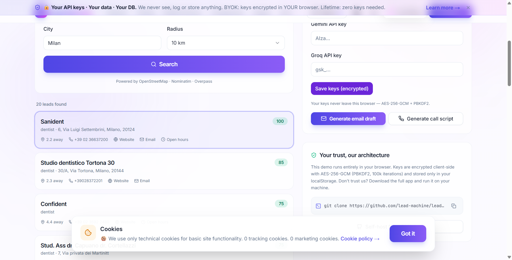

# Lead Machine — Marketing Website

> The official marketing site for **Lead Machine**, the open-source, self-hosted lead generation CRM.
> Built with Next.js 14 (App Router), next-intl, Tailwind CSS and shadcn/ui. Fully translated in **7 languages**, with a **live in-browser demo** that searches real businesses on OpenStreetMap and generates AI outreach with the visitor's own API keys (BYOK) or free credits.

<div align="center">

**🌐 [Live demo](#-live-demo) · 🚀 [Quick start](#-quick-start) · 🗺️ [Pages](#-pages) · 💬 [Translations](#-translations) · ⚙️ [Environment variables](#-environment-variables) · ☁️ [Deploy to Vercel](#-deploy-to-vercel)**

[](#)
[](#)
[](#)
[](#)
[](../LICENSE)

</div>



---

## Table of contents

- [What is this?](#-what-is-this)
- [Live demo](#-live-demo)
  - [Lead search (no API keys needed)](#1-lead-search--no-api-keys-needed)
  - [AI outreach with BYOK](#2-ai-outreach-with-byok)
  - [Free AI credits](#3-free-ai-credits)
  - [Credits API route](#credits-api-route)
- [Pages](#-pages)
- [Translations](#-translations)
- [Quick start](#-quick-start)
- [Scripts](#-scripts)
- [Environment variables](#-environment-variables)
- [Project layout](#-project-layout)
- [Deploy to Vercel](#-deploy-to-vercel)
- [FAQ](#-faq)

---

## 🧭 What is this?

This folder (`website/`) contains the public-facing marketing website of Lead Machine:

- **Landing page** with hero, features, pricing, BYOK & privacy, transparency, deploy, FAQ and CTA sections.
- **Product pages**: Features, Pricing, BYOK & Privacy (lifetime), Transparency, Deploy.
- **Live Demo** (`/demo`): a real, working product demo that runs entirely in the visitor's browser.
- **Legal pages** (privacy, terms, cookies, imprint, DPA, security), **forms** (demo request, partnership, bug report, waitlist) and **resource pages** (docs, blog, changelog, roadmap, contributors, status, about).
- **7 languages**: English, Italian, German, French, Slovenian, Spanish, Portuguese — with automatic locale detection and redirects (`/` → `/en`, `/DE` → `/de`, …).
- **SEO**: per-locale sitemap (`/sitemap.xml`), robots.txt, Open Graph image, canonical URLs, metadata in every locale.

---

## 🌐 Live demo

The page [`/[locale]/demo`](src/app/[locale]/demo/page.tsx) is a **real demo** — no fake data, no simulations. It is built from the same ideas as the main Lead Machine app:

```
[ 1 · Find leads ]      [ 2 · AI outreach (optional) ]
+-----------------+     +-----------------------------+
| category / city |     | Gemini / Groq key inputs    |
| radius          |     | 10 free credits badge       |
| [ Search ]      |     | Generate email / call script|
| leads list      |     | output + copy               |
| (score, phone…) |     +-----------------------------+
+-----------------+     [ Trust bar: keys never leave ]
                        [ git clone …                ]
```

### 1. Lead search (no API keys needed)

Client-side, against the free OpenStreetMap ecosystem — see [`src/lib/demo/lead-search.ts`](src/lib/demo/lead-search.ts):

1. **Geocoding** — the city is geocoded with [Nominatim](https://nominatim.openstreetmap.org).
2. **Business search** — an [Overpass](https://overpass-api.de) query looks for nodes/ways tagged with the category as `amenity`, `craft` or `shop`, inside the chosen radius (5–50 km, 20 results max).
3. **Lead scoring (0–100)** — heuristic score based on presence of **phone (+30)**, **website (+20)**, **email (+25)**, **opening hours (+15)**, plus name (+10). Sorted by score.
4. **Rich contact data** — phone, website, email, opening hours, address and distance from the city center are shown for every lead.

### 2. AI outreach (with BYOK)

The AI panel lets visitors generate a **cold email draft** or a **12-line call script** for the selected lead. Two modes:

| Mode | How it works |
|---|---|
| **BYOK (default)** | Visitor pastes a **Gemini** (`AIza…`) or **Groq** (`gsk_…`) key. The key is encrypted **client-side** with AES-256-GCM + PBKDF2 (100k iterations, random salt + IV — see [`src/lib/crypto.ts`](src/lib/crypto.ts)) and stored only in the visitor's `localStorage`. It **never** reaches our server. |
| **Free credits** | If the visitor has no key, the request goes to the serverless route [`/api/demo-ai`](src/app/api/demo-ai/route.ts), which proxies to Gemini using the site's own `DEMO_AI_KEY`. |

- AI calls are made directly from the browser to `generativelanguage.googleapis.com` or `api.groq.com` (both support CORS).
- Output is shown in a monospace box with a one-click **Copy** button + toast.

### 3. Free AI credits

Every visitor gets **10 free AI credits** (enough to test the email + script generators):

- The **server is the source of truth**: `/api/demo-ai` tracks usage per **IP address** in memory (10 requests / 24 hours, enforced server-side, immune to `localStorage` clearing).
- The **client keeps a mirror counter** in `localStorage` (`lm_demo_credits`) for instant UI updates, and syncs it with the `remaining` value returned by the server after every successful call.
- When credits run out (HTTP 429), the panel shows a hint inviting the visitor to add their own Gemini/Groq key (unlimited, free forever).
- If `DEMO_AI_KEY` is **not configured**, the route returns `{ notConfigured: true }` and the UI falls back **automatically** to BYOK mode.

### Credits API route

**`POST /api/demo-ai`** — request:

```json
{ "prompt": "…" }
```

Responses:

| Status | Body | Meaning |
|---|---|---|
| `200` | `{ "text": "…", "remaining": 9 }` | Success (1 credit used). |
| `200` | `{ "notConfigured": true }` | `DEMO_AI_KEY` not set → client should use BYOK. |
| `429` | `{ "remaining": 0, "error": "quota" }` | Daily credit quota reached for this IP. |
| `400` | `{ "error": "bad_request" }` | Missing / too long prompt. |
| `502` | `{ "error": "…" }` | Upstream AI provider error. |

**Security**: the server never sees visitor keys; it only proxies the *prompt*. Input is length-limited (8000 chars), and the IP quota prevents abuse.

---

## 📄 Pages

| Route (per locale) | Kind | Description |
|---|---|---|
| `/` | Landing | Hero + features + showcase + pricing + BYOK + transparency + deploy + FAQ + CTA |
| `/features` | Static | Feature deep-dive with tabs |
| `/pricing` | Static | BYOK lifetime €0 vs Open-Source free + comparison table |
| `/byok-lifetime` | Static | Bring-Your-Own-Key / lifetime licensing details |
| `/transparency` | Static | Data, cookies, open source, security, financial transparency |
| `/deploy` | Static | Local / VPS / serverless install commands (copy buttons) |
| `/demo` | **Dynamic** | The live demo (see above) |
| `/docs`, `/blog`, `/changelog`, `/roadmap`, `/contributors`, `/status`, `/about` | Static | Resource pages |
| `/privacy`, `/terms`, `/cookies`, `/imprint`, `/dpa`, `/security` | Static | Legal pages |
| `/demo-request`, `/partnership`, `/report-issue`, `/waitlist` | Static | Contact forms |

All pages are pre-rendered statically (SSG) for every locale — 174 static pages in total. The `/[locale]/[page]` dynamic route uses `generateStaticParams` with `dynamicParams = false`, so unknown URLs return a 404.

---

## 💬 Translations

All UI strings live in [`messages/{en,it,de,fr,sl,es,pt}.json`](messages) (next-intl). To change a string or add a language:

1. Edit the JSON file(s). **Key parity is required** across all 7 locales or the build fails with `MISSING_MESSAGE`.
2. For bulk additions, copy the pattern of the scripts in [`scripts/`](scripts) (they load the English file, add the new namespace, and write it back in every language).
3. Add the locale to [`src/i18n/config.ts`](src/i18n/config.ts) (`locales`, `localeLabels`, `isValidLocale`).
4. Run `npm run typecheck && npm run build`.

> ⚠️ **next-intl quirk**: nested namespaces as *dynamic strings* don't work (`getTranslations({ namespace: "legal." + slug })` throws). Dynamic namespaces are read with `t.raw("legal." + slug)` from the root namespace — see [`src/components/legal-page.tsx`](src/components/legal-page.tsx).

---

## 🚀 Quick start

```bash
cd website
npm install
npm run dev          # http://localhost:3001
```

Verify:

```bash
npm run typecheck    # TypeScript strict
npm run lint         # ESLint
npm run build        # production build (174 static pages)
```

> The site runs on port **3001** by default so it doesn't clash with the main app (`npm run dev` in the repo root uses port 3000).

---

## 📜 Scripts

| Script | Purpose |
|---|---|
| [`scripts/add-translations.cjs`](scripts/add-translations.cjs) | Adds a set of namespaces (`cta`, `deploy.copied`, `forms`, `resources`) to all 7 locales. |
| [`scripts/patch-missing-keys.cjs`](scripts/patch-missing-keys.cjs) | Adds missing keys (`nav.language`, `nav.partnership`, `meta.license`) to all locales. |
| [`scripts/add-demo-translations.cjs`](scripts/add-demo-translations.cjs) | Adds the whole `demo` namespace + `pricing.included`, `cta.demo`, `nav.liveDemo`. |
| [`scripts/add-showcase-translations.cjs`](scripts/add-showcase-translations.cjs) | Adds the `showcase` namespace. |

---

## ⚙️ Environment variables

Copy `.env.example` → `.env.local` (only needed for deployment / custom branding):

| Variable | Default | Purpose |
|---|---|---|
| `NEXT_PUBLIC_SITE_URL` | `http://localhost:3001` | Canonical site URL (sitemap, robots, metadata). |
| `NEXT_PUBLIC_APP_NAME` | `Lead Machine` | Brand name in UI. |
| `NEXT_PUBLIC_GITHUB_REPO` | `https://github.com/AxsenXzc/lead-machine` | GitHub URL used for all "star / self-host / clone" buttons. |
| `NEXT_PUBLIC_SUPPORT_EMAIL` | `hello@leadmachine.dev` | Contact email. |
| `DEMO_AI_KEY` | *(empty)* | **Server-only** Gemini API key that powers the 10 free demo credits. Empty → demo falls back to BYOK. |

---

## 📁 Project layout

```
website/
├── messages/                # next-intl dictionaries (7 locales, ~380 keys each)
├── public/
│   ├── og-image.png         # Open Graph image (1200×630)
│   ├── logo.png, icon-*, favicon.ico, site.webmanifest
│   └── product-screenshots/
│       └── screenshot-demo.png   # real screenshot of the live demo in action
├── scripts/                 # translation helper scripts
└── src/
    ├── middleware.ts        # next-intl locale redirect (REQUIRED here, not at root)
    ├── app/
    │   ├── [locale]/        # page.tsx, features, pricing, byok-lifetime,
    │   │                    # transparency, deploy, demo, [page] (legal/forms/resources)
    │   ├── api/demo-ai/route.ts   # free-credits AI proxy
    │   ├── sitemap.ts       # per-locale sitemap
    │   ├── robots.ts        # dynamic robots.txt
    │   └── layout.tsx       # root layout (fonts, theme, metadata)
    ├── components/
    │   ├── demo/            # demo-app, lead search, results, AI panel, trust bar
    │   ├── sections/        # hero, features, showcase, pricing, byok, transparency,
    │   │                    # deploy, faq, cta, reveal, section-header
    │   └── ui/              # shadcn/ui primitives
    ├── i18n/                # next-intl config, request, navigation
    └── lib/
        ├── crypto.ts        # BYOK AES-256-GCM + PBKDF2 encryption (shared with the app)
        ├── demo/            # lead-search (Nominatim+Overpass) and ai.ts (Gemini/Groq)
        └── site.ts          # central GitHub/email constants
```

---

## ☁️ Deploy to Vercel

1. Push this repo to GitHub and import it in Vercel.
2. **Root directory**: `website`.
3. **Framework preset**: Next.js (auto-detected).
4. Environment variables (see table above); set **`DEMO_AI_KEY`** with a Google AI Studio key to enable the free demo credits.

The build runs `next build` and outputs 174 static pages + the `/api/demo-ai` serverless function.

> Tip: `DEMO_AI_KEY` is a **server-side** variable (not `NEXT_PUBLIC_`), so it never reaches the browser.

---

## ❓ FAQ

**Is the demo safe? Can Lead Machine see my API keys?**
No. Keys are encrypted with AES-256-GCM (PBKDF2, 100k iterations) and stored only in your browser's `localStorage`. They are sent directly to Gemini/Groq from your browser — the Lead Machine server never sees them. Don't trust us? `git clone` the whole app and run it locally.

**What if I use up my 10 credits?**
Add your own Gemini or Groq key in the AI panel — unlimited and free forever.

**Why do searches need internet?**
The demo queries the free Nominatim / Overpass OpenStreetMap APIs. The full Lead Machine app works offline (except AI and live map tiles).

**Can I add an 8th language?**
Yes — see [Translations](#-translations).

---

### 👨‍💻 A DevDuos Creation
This project is the result of a powerful collaboration:
- **Vision & Idea by:** Axsen Kurtoski (teenager developer & visionary)
- **Built by:** Artificial Intelligence (OpenCode / Antigravity)

Made with ❤️ for freelancers worldwide. Open-source under [MIT](../LICENSE).
